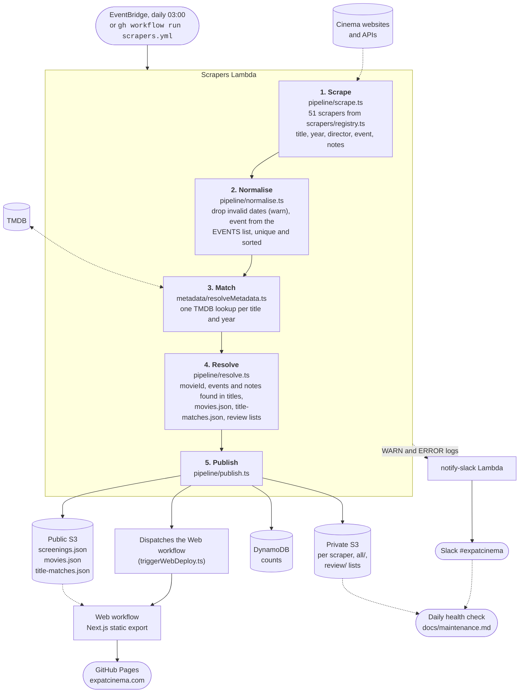
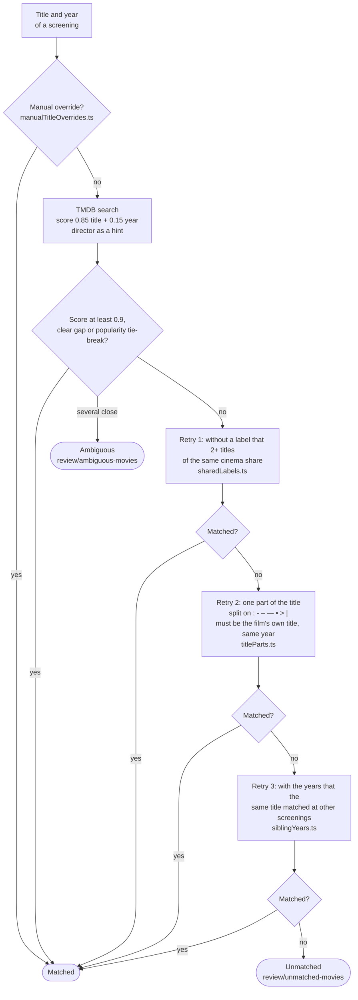
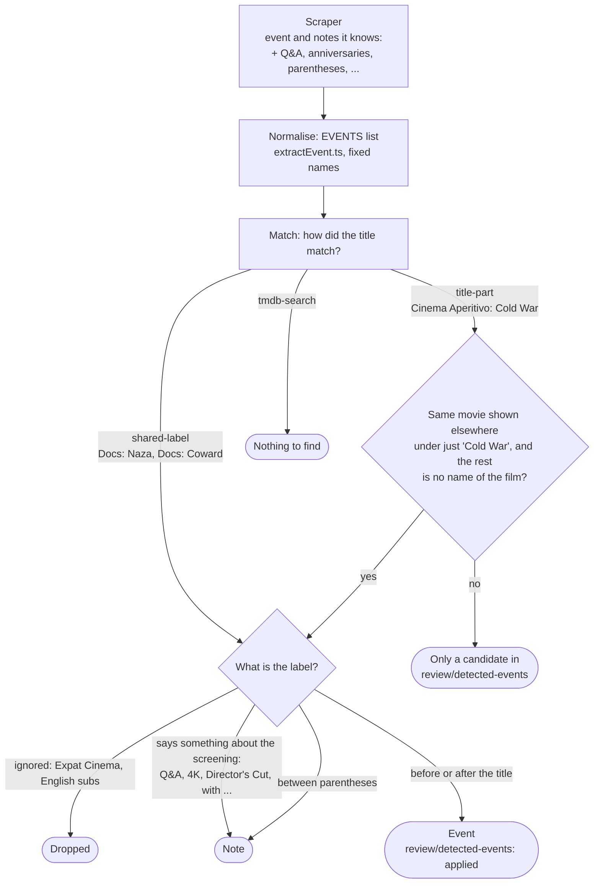

# Pipeline

How a screening gets from a cinema's website to expatcinema.com. The code is in `cloud/` (`cloud/scrapers/index.ts` only calls the phases, in order); the text for each phase is in [`AGENTS.md`](../AGENTS.md#cloud-pipeline-phases).

## Overview

## Match phase

Every unique title and year gets one lookup. A title that doesn't match is retried, in this order, and stops at the first retry that matches.

## Events and notes

A scraper sets `event` and `notes` itself where it can. What it leaves open is filled in later, and a screening keeps what a scraper set.

